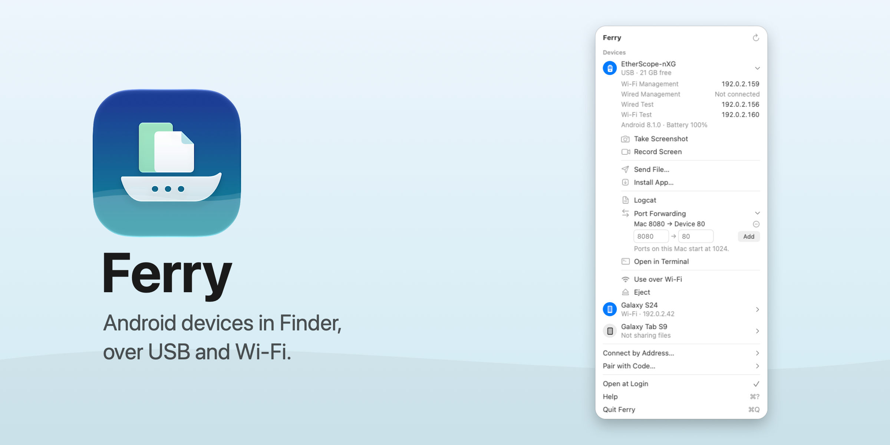
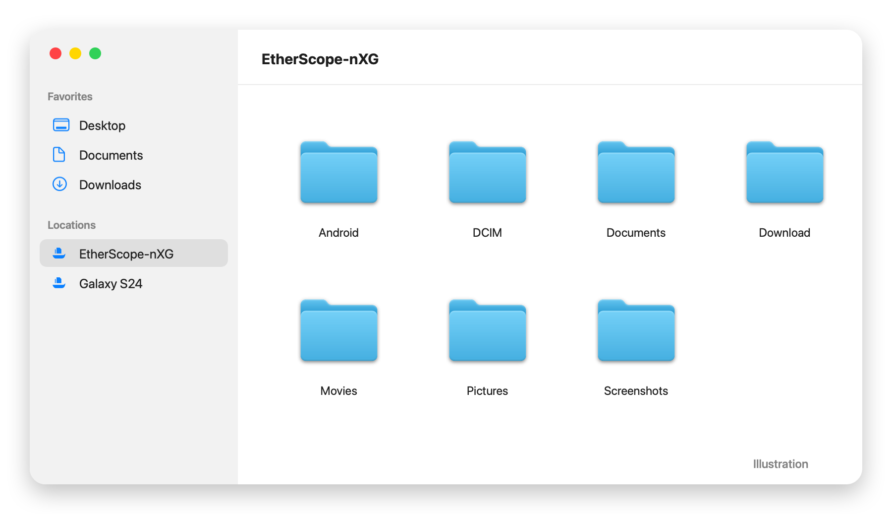
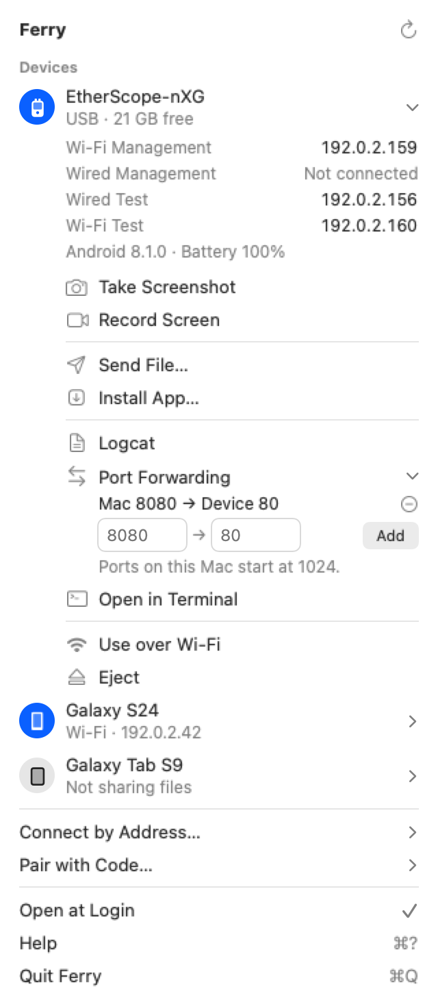
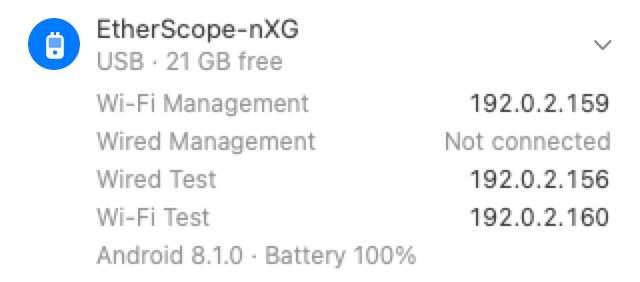
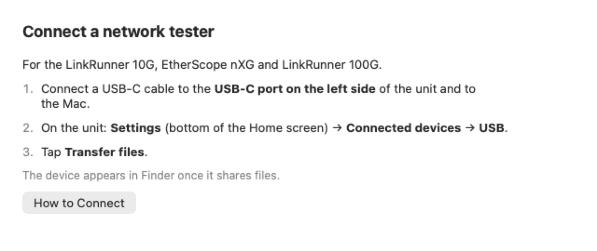

<p align="center">
  <picture>
    <source media="(prefers-color-scheme: dark)" srcset="Design/README/hero-dark.png">
    
  </picture>
</p>

Ferry is a small menu-bar app that shows Android devices as locations in Finder. It was built
for field engineers who carry network testers (LinkRunner 10G, EtherScope nXG,
LinkRunner 100G) and need to move test results, captures and files between the tester and a
Mac. It works with other Android phones too. macOS has no built-in way to browse an Android
device over USB; Ferry adds one that uses Finder itself, so you browse, open, copy, rename and
delete with the tools you already know, including any app's Open and Save dialogs. With USB
debugging and `adb`, Ferry also reaches devices over ADB, by cable or over Wi-Fi, which is faster
and adds tools: installing apps, screenshots, screen recordings, logcat, a shell and port
forwarding. It is free and open source (MIT), and it sends nothing about you or your devices:
it connects only to GitHub, to check for updates, and to Google, to download adb once you
accept Google's license and again when a Ferry update needs a newer adb.

| Finder | The menu |
| ------ | -------- |
| <picture><source media="(prefers-color-scheme: dark)" srcset="Design/README/finder-dark.png"></picture> | <picture><source media="(prefers-color-scheme: dark)" srcset="Design/README/menu-dark.png"></picture> |
| Each device is a location in Finder's sidebar. (Illustration: Finder can't be drawn offscreen.) | One row per device; open one for its details and tools. |

| Device details | Help |
| -------------- | ---- |
| <picture><source media="(prefers-color-scheme: dark)" srcset="Design/README/details-dark.png"></picture> | <picture><source media="(prefers-color-scheme: dark)" srcset="Design/README/help-dark.png"></picture> |
| A device's addresses, Android version and battery, right in the menu. | Step-by-step help, opened from any problem the menu shows. |

The images are drawn from the app's own views; `scripts/readme-images.sh` renders them again.

## Requirements

- macOS 26 or later, Apple silicon
- A USB cable that carries data
- An Android device with file transfer (MTP): LinkRunner 10G, EtherScope nXG,
  LinkRunner 100G, or an Android 8+ phone
- Optional, for USB debugging, Wi-Fi and the tools: `adb`, from Google's Android platform tools.
  Ferry uses one already on the Mac. Without one, the menu offers **Get Android Platform
  Tools…**: after you accept Google's Android SDK License, Ferry downloads Google's release once
  from `dl.google.com`, checks its SHA-256 and Google's code signature, and keeps only `adb`.
  Ferry never bundles Google's binaries.

## Install

1. Download `Ferry-<version>.dmg` (or the `.zip`) from the
   [latest release](https://github.com/krisarmstrong/ferry/releases/latest), drag **Ferry** to
   **Applications** and open it. Releases are signed with a Developer ID and notarized by Apple.
   To build Ferry yourself instead, see [Build from source](#build-from-source).
2. In **System Settings → General → Login Items & Extensions**, turn on **Ferry** under
   **File Providers**. The Ferry menu has a button that opens the right page.
3. For **Send to** in Finder's Control-click menu, turn on Ferry's Finder extension on the same
   page, under **Extensions**.

Ferry updates itself. It checks GitHub once a day, downloads a new release in the background
and installs it when Ferry quits; **Check for Updates…** in the menu checks now. Every update
must carry the signature of Ferry's EdDSA release key and a valid code signature; releases are
signed with a Developer ID and notarized by Apple. See
[Updates](docs/user-guide.md#updates).

## Quick start

**LinkRunner 10G, EtherScope nXG, LinkRunner 100G**

1. Connect a USB-C cable to the **USB-C port on the left side** of the unit and to the Mac.
2. On the unit: **Settings** → **Connected devices** → **USB**.
3. Tap **Transfer files**.

**Other Android phones:** unlock the phone, tap the USB notification and choose
**Transfer files** (Android 8–9) or **File transfer** (Android 10 and newer).

The device appears in Finder's sidebar under **Locations**. If it does not, see
[Troubleshooting](docs/user-guide.md#troubleshooting).

**With USB debugging:** turn on USB debugging on the device and allow this Mac when it asks;
Ferry then serves the device over ADB and shows its tools in the menu. From there, **Use over
Wi-Fi**, **Pair with Code…** and **Connect by Address…** reach a device over the network. See
[Turn on USB debugging](docs/user-guide.md#turn-on-usb-debugging) and
[Use a device over Wi-Fi](docs/user-guide.md#use-a-device-over-wi-fi).

Full instructions: [User guide](docs/user-guide.md). The same help is in the app: choose
**Help** in the Ferry menu, or click the **?** beside a problem in the menu to open its entry.

## Build from source

Requires Xcode 26.6 or later (Swift 6.3), [XcodeGen](https://github.com/yonaskolb/XcodeGen),
SwiftLint and Homebrew's libmtp.

```sh
brew install libmtp swiftlint xcodegen

make app     # Ferry.app, with its helper and extensions, in .build/xcode/Build/Products/Debug
make test    # unit tests, no device needed
make lint fmt-check
```

`make app` signs with an Apple Development identity of the team in `FERRY_TEAM_ID`
(`project.yml`; the project's own team by default). To build with your own team, pass its
ten-character team ID:

```sh
make app TEAM=ABCDE12345
```

The team ID also names Ferry's app group and its helper's XPC service, and Ferry's four parts
(the app, its helper, the FileProvider extension and the Finder extension) only talk to each
other when signed by that team, so all four take it from the build (each records it as
`FerryTeamID` in its Info.plist). `make app` checks that every part carries it. Device integration tests are off by default; see [docs/TESTING.md](docs/TESTING.md).

`ferryctl` is a command-line front end for testing against a real device. Turn on file
transfer first, then:

```sh
swift run ferryctl devices
swift run ferryctl storages
swift run ferryctl ls /DCIM
swift run ferryctl get /DCIM/Camera/photo.jpg ./photo.jpg [--replace]
swift run ferryctl put ./notes.md /Download/notes.md [--replace]
swift run ferryctl mkdir /Download/new
swift run ferryctl mv /Download/notes.md /Download/new
swift run ferryctl rename /Download/new/notes.md renamed.md
swift run ferryctl rm /Download/new
```

`--device <serial>` picks a device (default: the first) and `--storage <description>` picks a
storage (default: the first).

## License

Ferry is released under the [MIT License](LICENSE).

Ferry uses [libmtp](https://github.com/libmtp/libmtp) and
[libusb](https://github.com/libusb/libusb), which are licensed under the GNU Lesser General
Public License, version 2.1. Ferry links them dynamically. Development builds load the copies
Homebrew installs; release builds ship the unmodified libraries, built from their release
tarballs by `scripts/build-libmtp.sh`, in `Ferry.app/Contents/Frameworks`, with their license
texts in `Contents/Resources/Licenses`. Their source code is available from the links above.

NetAlly, LinkRunner, EtherScope and AirCheck are trademarks of NetAlly. Ferry is not affiliated
with or endorsed by NetAlly. Android is a trademark of Google LLC.
