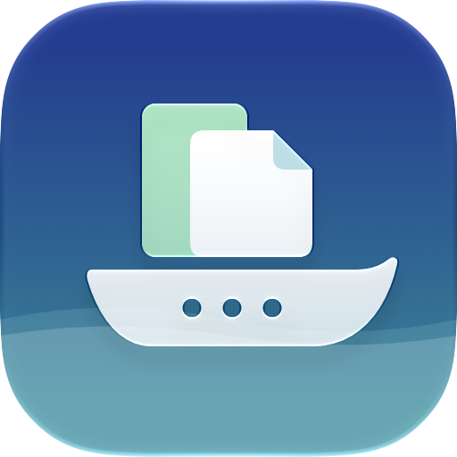

<p align="center">
  
</p>

<h1 align="center">Ferry</h1>

<p align="center">Android devices in Finder, over USB.</p>

Ferry is a small menu-bar app that shows Android devices as locations in Finder. It was built
for field engineers who carry NetAlly network testers (LinkRunner 10G, EtherScope nXG,
LinkRunner 100G) and need to move test results, captures and files between the tester and a
Mac. It works with other Android phones too. macOS has no built-in way to browse an Android
device over USB; Ferry adds one that uses Finder itself, so you browse, open, copy, rename and
delete with the tools you already know, including any app's Open and Save dialogs. It is free
and open source (MIT), and it never uses the network.

<!-- Screenshots: replace the placeholders once captured on macOS 26. -->

| Finder | Menu | Setup guide |
| ------ | ---- | ----------- |
|  |  |  |

## Requirements

- macOS 26 or later, Apple silicon
- A USB cable that carries data
- An Android device with file transfer (MTP): NetAlly LinkRunner 10G, EtherScope nXG,
  LinkRunner 100G, or an Android 8+ phone

## Install

1. Download `Ferry.dmg` from [Releases](https://github.com/krisarmstrong/ferry/releases).
2. Drag **Ferry** to **Applications** and open it.
3. In **System Settings → General → Login Items & Extensions**, turn on **Ferry** under
   **File Providers**. The Ferry menu has a button that opens the right page.

A Homebrew cask is planned.

## Quick start

**NetAlly LinkRunner 10G, EtherScope nXG, LinkRunner 100G**

1. Connect a USB-C cable to the **USB-C port on the left side** of the unit and to the Mac.
2. On the unit: **Settings** → **Connected devices** → **USB**.
3. Tap **Transfer files**.

**Other Android phones:** unlock the phone, tap the USB notification and choose
**Transfer files** (Android 8–9) or **File transfer** (Android 10 and newer).

The device appears in Finder's sidebar under **Locations**. If it does not, see
[Troubleshooting](user-guide.md#troubleshooting).

Full instructions: [User guide](user-guide.md).

## Build from source

Requires Xcode 27 (with Swift 6), [XcodeGen](https://github.com/yonaskolb/XcodeGen),
SwiftLint and Homebrew's libmtp.

```sh
brew install libmtp swiftlint xcodegen
export DEVELOPER_DIR=/Applications/Xcode.app/Contents/Developer

make app     # Ferry.app, with its helper and Finder extension, in .build/xcode/Build/Products/Debug
make test    # unit tests, no device needed
make lint fmt-check
```

`make app` signs with your Apple Development identity. Device integration tests are off by
default; see [docs/TESTING.md](TESTING.md).

`ferryctl` is a command-line front end for testing against a real device:
`swift run ferryctl devices`.

## License

Ferry is released under the [MIT License](../LICENSE).

Ferry uses [libmtp](https://github.com/libmtp/libmtp) and
[libusb](https://github.com/libusb/libusb), which are licensed under the GNU Lesser General
Public License, version 2.1. Release builds link them dynamically and ship the unmodified
libraries in `Ferry.app/Contents/Frameworks`, with their license texts. Their source code is
available from the links above; you may replace those libraries with your own builds.

NetAlly, LinkRunner, EtherScope and AirCheck are trademarks of NetAlly. Ferry is not affiliated
with or endorsed by NetAlly. Android is a trademark of Google LLC.
